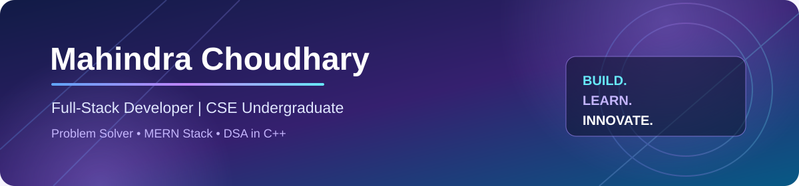

<!--
  GitHub Profile README
  Repository: Mahindra021/Mahindra021
  Add the banner at: assets/profile-banner.svg
  Configure the contribution snake workflow before publishing.
-->

 

  
  

---

## 👨‍💻 About Me

Hello! I'm **Mahindra Choudhary**, a Computer Science and Engineering undergraduate at **Parul University**, passionate about software engineering, full-stack development, and algorithmic problem-solving.

I enjoy designing and developing practical applications, building secure backend systems, and solving challenging DSA problems using C++.

I'm also expanding my knowledge of Data Science and AI/ML through Python, data analysis, and visualization.

- 🔭 Currently building and improving full-stack applications.
- 🌱 Exploring AI/ML, Data Science, and modern web technologies.
- 💻 Practicing Data Structures & Algorithms using C++.
- ⚙️ Interested in backend architecture, REST APIs, authentication, and database design.
- 🎯 Aspiring Software Engineer.
- 📍 Surat, Gujarat, India.
- 📫 **Email:** mahindrachoudhary48@gmail.com

---

## 📌 Developer Snapshot

| 🎓 Education | 📊 CGPA | 🧩 DSA Practice |
|:---:|:---:|:---:|
| B.Tech CSE | 8.70 / 10 | 1000+ Problems |

| ⚡ LeetCode | 🏆 Contest Rating | 🎯 Graduation |
|:---:|:---:|:---:|
| 470+ Problems | 1509 Maximum | May 2027 |

---

## 🛠️ Technical Arsenal

### Programming Languages

  

### Frontend Development

  

### Backend & Database

  

### Data Science & AI/ML

  
  
  
  

### Developer Tools & Platforms

  
  
  

### Core Computer Science

`Data Structures & Algorithms` · `OOP` · `DBMS` · `Operating Systems` · `Computer Networks` · `Software Engineering`

---

## 🚀 Featured Projects

### ✈️ Dastak — AI-Powered Travel Planning & Expense Analytics

A full-stack travel platform that combines AI-generated itineraries with expense management and travel analytics.

**What I built:**
- Personalized day-wise travel itineraries using Google Gemini API.
- Trip creation, editing, management, and sharing.
- Expense tracking and category-wise analytics.
- Budget monitoring and expense visualization.
- Cloudinary image storage and PDF report export.

**Tech Stack:** React.js · Node.js · Express.js · MongoDB · Redux Toolkit · Gemini API · Cloudinary

### 🏙️ FixFlow — Civic Issue Reporting Platform

A civic-tech application designed to connect citizens and municipal authorities through a centralized issue-reporting and resolution workflow.

**What I built:**
- Civic issue reporting and tracking workflows.
- Secure REST APIs with JWT authentication.
- Role-based access control and protected middleware.
- MongoDB schema design.
- Issue assignment, status management, and resolution workflows.

**Tech Stack:** React.js · Node.js · Express.js · MongoDB · JWT · RBAC

### 🎓 UniHub — AI-Powered University Management System

A collaborative MERN-based university management platform designed to simplify academic and administrative operations.

**What I contributed:**
- Four role-based dashboards for Admin, Students, Teaching Staff, and Non-Teaching Staff.
- JWT authentication and server-side authorization.
- Role-aware AI assistant for context-aware university services.
- Attendance, examinations, fees, library, and hostel management modules.

**Tech Stack:** MongoDB · Express.js · React.js · Node.js · JWT · RBAC

  

---

## 🏆 Achievements & Recognition

| Achievement | Recognition |
|:---|:---|
| 🥇 Tech X — September 2026 | First Position for UniHub |
| 💻 DSA | 1000+ Problems Solved |
| ⚡ LeetCode | 470+ Problems Solved |
| 📈 LeetCode Contest | 1509 Maximum Rating |
| 🤖 C-DAC Pune | Artificial Intelligence Bootcamp |
| 🌐 NPTEL | Computer Networks Certification |

- Participated in Guidewire DEVTrails University Hackathon 2026.
- Participated in Vadodara Hackathon 6.0.

---

## 📊 GitHub Analytics

  

---

## 🧠 Competitive Programming

I consistently practice algorithmic problems to strengthen my understanding of data structures, algorithms, and efficient problem-solving.

 

---

## 🐍 Contribution Activity

---

## 📜 Certifications

<b>View certifications and achievements</b>

 

- Artificial Intelligence Bootcamp — C-DAC Pune, FutureSkills PRIME.
- NPTEL Certification — Computer Networks.
- First Position — Tech X, September 2026, UniHub project.
- Guidewire DEVTrails University Hackathon 2026 — Participant.
- Vadodara Hackathon 6.0 — Participant.

---

## 🤝 Let's Connect

I'm always open to connecting with developers, collaborating on interesting projects, and exploring software engineering opportunities.

  

### 💜 "Code. Learn. Build. Repeat."

⭐ Thanks for visiting my profile. Feel free to explore my work!

